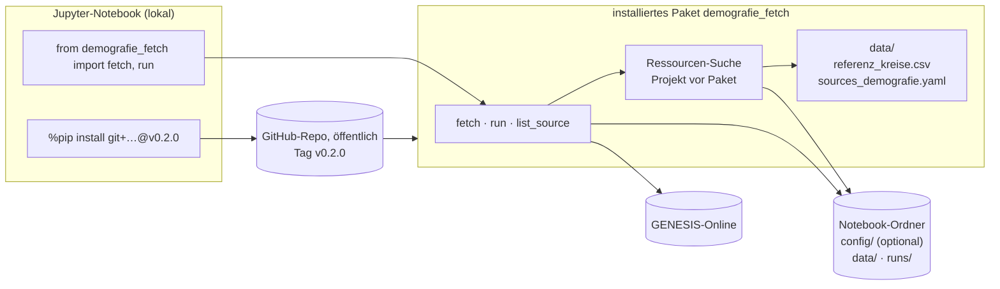
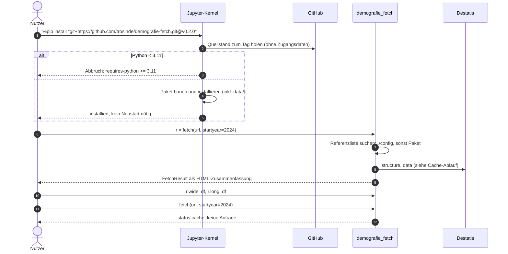
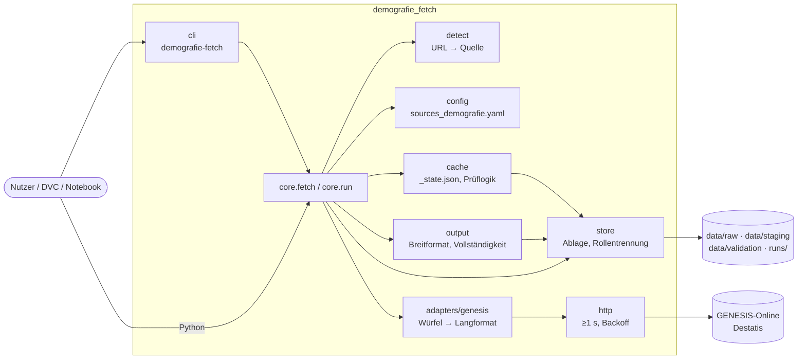
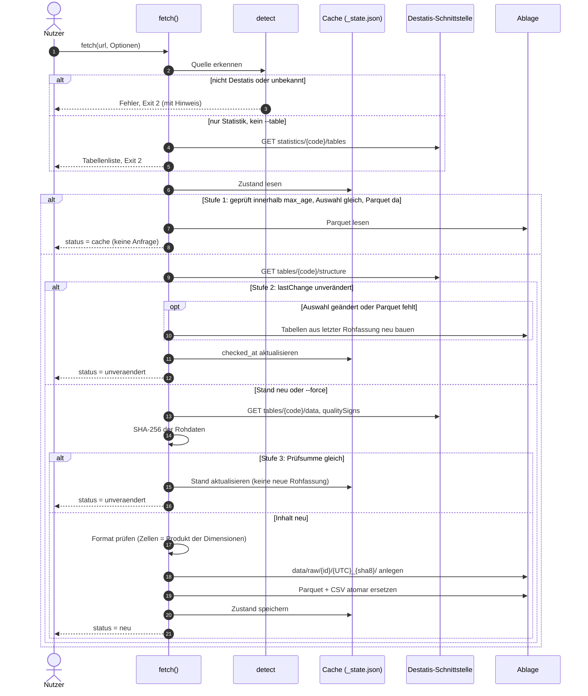
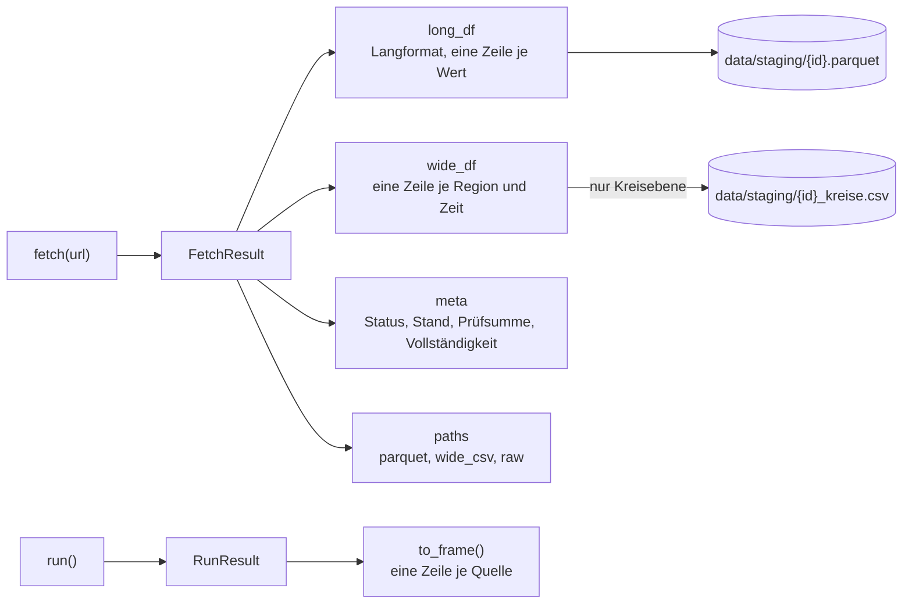

# demografie-fetch

**URL rein, Tabelle je Kreis raus.** `demografie-fetch` holt amtliche Demografiedaten für die Immobilien-Ampel Deutschland. Du gibst die URL einer Tabelle an. Die Komponente erkennt die Quelle, übernimmt die Werte exakt (ohne Rundung oder Schätzung) und schreibt ein Langformat (Parquet) für die Pipeline und eine breite Tabelle je Kreis (CSV). Ein Cache sorgt dafür, dass nur geladen wird, was sich an der Quelle geändert hat.

- [Schnellstart](#schnellstart)
- [Im Jupyter-Notebook](#im-jupyter-notebook)
- [Wie verwende ich die Komponente?](#wie-verwende-ich-die-komponente)
- [So funktioniert es](#so-funktioniert-es)
- [Was kommt heraus?](#was-kommt-heraus)
- [Quellen](#quellen)
- [Neue Quelle eintragen](#neue-quelle-eintragen)
- [Nachschlagen](#nachschlagen): Optionen, Cache, Ablage, Exit-Codes, Entwicklung

## Schnellstart

```bash
git clone https://github.com/trosinde/demografie-fetch.git && cd demografie-fetch
uv sync
uv run demografie-fetch "https://genesis.destatis.de/datenbank/online/statistic/12411/table/12411-0017" --startyear 2024
```

Ausgabe beim ersten Aufruf:

```
bevoelkerung_kreise_alter: neu  Tabelle 12411-0017  Stand 2026-09-21T09:08:47.596Z  17172 Zeilen
  parquet: data/staging/bevoelkerung_kreise_alter.parquet
  raw: data/raw/bevoelkerung_kreise_alter/20261024T132850Z_9762087d
  wide_csv: data/staging/bevoelkerung_kreise_alter_kreise.csv
  Kreise: Referenz 400, 2 Zeitpunkte, 0 mit Abweichung
Manifest: runs/20261024T132854Z/manifest_demografie.json
```

Derselbe Aufruf gleich danach lädt nichts, sondern meldet `cache`. Nach Ablauf des Prüfintervalls kommt `unveraendert`, solange Destatis die Tabelle nicht geändert hat.

Die Quell-ID `bevoelkerung_kreise_alter` stammt aus `config/sources_demografie.yaml`, weil die URL dort eingetragen ist. Für andere URLs bildet die Komponente eine ID aus dem Tabellencode, z. B. `destatis_12411_0015`.

## Im Jupyter-Notebook

Lokal in JupyterLab oder VS Code, Kernel mit **Python 3.11 oder neuer**. Eine fertige Vorlage ist [`notebooks/schnellstart.ipynb`](notebooks/schnellstart.ipynb); CI führt sie bei jeder Änderung vollständig aus.

**Installation** (erste Zelle):

```python
%pip install -q "git+https://github.com/trosinde/demografie-fetch.git@v0.2.0"
```

- `%pip` statt `!pip`, damit in die Umgebung des laufenden Kernels installiert wird. Ein Neustart ist danach nicht nötig.
- Der Tag (`@v0.2.0`) legt die Version fest. Ohne Tag wird der aktuelle Stand von `main` installiert.
- Ein Klon des Repos ist nicht nötig: Referenzliste der Kreise und Beispielkonfiguration sind im Paket enthalten.

**Ausführung:**

```python
from demografie_fetch import fetch, list_source, run

URL = "https://genesis.destatis.de/datenbank/online/statistic/12411/table/12411-0015"
print(list_source(URL))                         # Struktur ansehen, lädt keine Daten

r = fetch(URL, startyear=2024, data_dir="nb-daten")
r                                               # Zusammenfassung als Tabelle
r.wide_df.head()                                # je Kreis und Stichtag eine Zeile
r.long_df                                       # Langformat
r.meta["vollstaendigkeit"]                      # 400 Kreise je Stichtag?

fetch(URL, startyear=2024, data_dir="nb-daten").meta["status"]   # 'cache'

ergebnis = run(data_dir="nb-daten")             # alle aktiven Quellen der Beispielkonfiguration
ergebnis.to_frame()                             # eine Zeile je Quelle
```

| Thema | Hinweis |
|---|---|
| Ablage | `data_dir` (Standard: Ordner des Notebooks) erhält `data/` und `runs/`. Ein eigener Ordner wie `nb-daten` hält das Notebook-Verzeichnis sauber. |
| Eigene Konfiguration | `run(config="pfad/quellen.yaml")` oder `config/sources_demografie.yaml` im Notebook-Ordner; sonst gilt die mitgelieferte. Das Manifest nennt, welche benutzt wurde. |
| Meldungen | `import logging; logging.basicConfig(level=logging.INFO)` zeigt je Quelle `neu`, `unveraendert` oder `cache`. |
| Fehler | Ausnahmen mit verständlicher Meldung, z. B. `InputError` mit der Tabellenliste bei einer Statistik-URL. |
| Speicher | 12421-0004 (alle Länder, Varianten, Altersjahre) hat 2 Mio. Zeilen und braucht rund 100 MB im Speicher; mit `select`/`startyear` lässt sich das verkleinern. |





## Wie verwende ich die Komponente?

### 1. Kommandozeile: eine Tabelle holen

```bash
# Erst ansehen, was drin ist (lädt keine Daten, schreibt nichts)
demografie-fetch "<url>" --list

# Holen, mit Auswahl
demografie-fetch "<url>" --startyear 2012 --select ALTX20=ALT000B03,ALT003B06

# Altersgruppe als Zeile statt als Spalte in der CSV
demografie-fetch "<url>" --wide zeit,altx20

# URL zeigt nur auf eine Statistik: Tabellen werden gelistet (Exit 2), dann wählen
demografie-fetch "https://genesis.destatis.de/datenbank/online/statistic/12411"
demografie-fetch "https://genesis.destatis.de/datenbank/online/statistic/12411" --table 12411-0017
```

### 2. Python, z. B. im Notebook

```python
from demografie_fetch import fetch

r = fetch("https://genesis.destatis.de/datenbank/online/statistic/12411/table/12411-0017",
          startyear=2024)
r.meta["status"]   # "neu", "unveraendert" oder "cache"
r.long_df          # Langformat, 17.172 Zeilen x 14 Spalten
r.wide_df          # je Kreis und Stichtag eine Zeile: 800 x 21
r.paths            # {"parquet": ..., "wide_csv": ..., "raw": ...}
```

Mehr dazu, auch zur Installation im Notebook: [Im Jupyter-Notebook](#im-jupyter-notebook).

Wiederholte Aufrufe im Notebook kommen innerhalb von 6 Stunden ohne Netzwerkzugriff aus dem Cache. Fehler werden als Ausnahmen gemeldet (`InputError`, `UnsupportedSourceError`, `BlockedError`, `FormatError`), jede mit `exit_code`.

### 3. Pipeline: alle Quellen aus der Konfiguration

```bash
demografie-fetch run                               # alle Quellen mit aktiv: true
demografie-fetch run --only kbv16_laender --force  # eine Quelle, ohne Änderungsprüfung
demografie-fetch check                             # antwortet die Schnittstelle?
```

`run` ruft die Quellen nacheinander ab. Scheitert eine, laufen die anderen weiter. Das Ergebnis jeder Quelle steht in `runs/<UTC>/manifest_demografie.json`.

In **DVC** als erste Stufe:

```yaml
stages:
  demografie_fetch:
    cmd: demografie-fetch run --max-age 0
    deps:
      - config/sources_demografie.yaml
    outs:
      - data/staging/kbv16_laender.parquet:
          persist: true
      - data/staging/bevoelkerung_kreise_alter.parquet:
          persist: true
    always_changed: true
  ampel_kontext:
    cmd: python pipeline/kontext.py
    deps:
      - data/staging/bevoelkerung_kreise_alter.parquet
    outs:
      - data/features/kontext.parquet
```

`always_changed: true` lässt die erste Stufe bei jedem `dvc repro` prüfen. Unveränderte Quellen fassen das Parquet nicht an, sein Hash bleibt gleich, und die Folgestufen rechnen nur bei echten Änderungen neu.

In **GitHub Actions** läuft `run` monatlich (Workflow `monthly`). Der Cache unter `data/` wird zwischen den Läufen aufbewahrt, Manifest und Tabellen kommen als Artefakt.

## So funktioniert es

### Bausteine



### Ablauf eines Abrufs mit Cache



Weitere Diagramme (Ablauf von `run`, Datenfluss) stehen in [`openspec/changes/archive/2026-10-24-add-genesis-adapter/design.md`](openspec/changes/archive/2026-10-24-add-genesis-adapter/design.md), die Zugangsprüfung in [`openspec/changes/archive/2026-10-24-add-access-probe/design.md`](openspec/changes/archive/2026-10-24-add-access-probe/design.md).

## Was kommt heraus?

Jeder Abruf liefert ein `FetchResult` mit vier Feldern: `long_df` (Langformat), `wide_df` (breite Tabelle), `meta` (Status und Prüfung) und `paths` (Dateien). Maßgeblich ist die Spezifikation [`openspec/specs/table-output/spec.md`](openspec/specs/table-output/spec.md); diese Seite fasst sie zusammen. Die Beispiele stammen aus echten Abrufen vom 24.10.2026 (Stand der Quellen 2026-09-21).



### Langformat: `long_df`

Eine Zeile je Zelle der Quelltabelle, abgelegt unter `data/staging/<quelle_id>.parquet`. Das Beispiel ist die erste Zeile von 12411-0017 (Kreisebene):

| Spalte | Typ | Beispiel | Erklärung |
|---|---|---|---|
| `quelle_id` | Text | `bevoelkerung_kreise_alter` | Quell-ID aus der Konfiguration, sonst aus dem Tabellencode (`destatis_12411_0015`) |
| `tabelle` | Text | `12411-0017` | GENESIS-Tabellencode |
| `zeit` | Text | `2024-12-31` | Stichtag, Format `JJJJ-MM-TT` |
| `ags5` | Text | `01001` | Kreisschlüssel, 5 Stellen mit führender Null (nur Kreisebene) |
| `altx20_code` | Text | `ALT000B03` | Altersgruppe, Schlüssel |
| `altx20_label` | Text | `unter 3 Jahre` | Altersgruppe, Bezeichnung |
| `kreise_code` | Text | `01001` | Kreisschlüssel aus GENESIS, gleich `ags5` |
| `kreise_label` | Text | `Flensburg, kreisfreie Stadt` | Name des Kreises |
| `merkmal_code` | Text | `BEVSTD` | Merkmal, Schlüssel |
| `merkmal_label` | Text | `Bevölkerungsstand` | Merkmal, Bezeichnung |
| `einheit` | Text | `Anzahl` | Einheit des Werts |
| `wert` | Zahl (`float64`) | `2388.0` | Wert in veröffentlichter Genauigkeit, ohne Rundung; leer bei Sonderzeichen |
| `sonderzeichen` | Text | `-` | Amtliches Zeichen, das den Wert ersetzt; leer, wenn keines zutrifft |
| `qualitaet` | Text | `e` | Kennzeichen, das den Wert begleitet; leer, wenn keines zutrifft |

Eine Zeile mit Sonderzeichen: Kreis `03152`, Altersgruppe `ALT000B03`, 2024-12-31. `wert` ist leer, `sonderzeichen` ist `-`.

Alle Textspalten sind im Parquet als Kategorie (Dictionary-kodierter Text) gespeichert und in pandas `category`.

**Quellabhängige Spalten.** Jede Dimension einer Tabelle ergibt zwei Spalten, `<dim>_code` und `<dim>_label`, wobei `<dim>` der kleingeschriebene Dimensionscode ist. Die Spalte `zeit` kommt aus der Zeitdimension `STAG`, die Regionen bekommen eigene Namen (`ags5` bzw. `land`). Welche Dimensionen eine Tabelle hat, zeigt `list_source(url)`.

| GENESIS-Dimension | Spalten | Beispiel | Vorkommen |
|---|---|---|---|
| `STAG` | `zeit` | `2024-12-31` | 12411-0017, 12421-0004 |
| `KREISE` | `ags5`, `kreise_code`, `kreise_label` | `01001`, `Flensburg, kreisfreie Stadt` | 12411-0017 |
| `ALTX20` | `altx20_code`, `altx20_label` | `ALT000B03`, `unter 3 Jahre` | 12411-0017 |
| `DLAND` | `land`, `dland_code`, `dland_label` | `08`, `Baden-Württemberg` | 12421-0004 |
| `GES` | `ges_code`, `ges_label` | `GESM`, `männlich` | 12421-0004 |
| `BEVPR2` | `bevpr2_code`, `bevpr2_label` | `BEV-VARIANTE-01`, `Geburtenrate und LE moderat, WS niedrig (G2L2W1)` | 12421-0004 |
| `ALT101` | `alt101_code`, `alt101_label` | `ALT000`, `unter 1 Jahr` | 12421-0004 |

Länderebene (12421-0004) hat keine Spalte `ags5`, stattdessen `land` (2-stellig, `08` = Baden-Württemberg). Eine Beispielzeile: `zeit` 2025-12-31, `ges_code` GESM, `bevpr2_code` BEV-VARIANTE-01, `dland_label` Baden-Württemberg, `alt101_code` ALT000, `merkmal_code` BEV050, `einheit` 1000, `wert` 47.9. Die Einheit `1000` steht für Angaben in Tausend.

**Zeichen.** Amtliche Zeichen laut GENESIS-Online:

| Spalte | Zeichen | Bedeutung |
|---|---|---|
| `sonderzeichen` | `-` | nichts vorhanden, genau Null oder zur Geheimhaltung auf Null geändert |
| `sonderzeichen` | `.` | Zahlenwert unbekannt oder geheim zu halten |
| `sonderzeichen` | `...` | Angabe fällt später an |
| `sonderzeichen` | `/` | keine Angabe, weil der Zahlenwert nicht sicher genug ist |
| `sonderzeichen` | `x` | Tabellenfach gesperrt, weil die Aussage nicht sinnvoll ist |
| `qualitaet` | `e` | endgültiger Wert |
| `qualitaet` | `p` | vorläufige Zahl |
| `qualitaet` | `r` | berichtigte Zahl |
| `qualitaet` | `s` | geschätzte Zahl |
| `qualitaet` | `()` | Aussagewert eingeschränkt, Zahlenwert statistisch relativ unsicher |
| `qualitaet` | `0` | Zahlenwert ungleich Null, aber auf Null gerundet |

Ein Zeichen in `sonderzeichen` lässt `wert` leer. Begleitende Zeichen stehen zusätzlich zum Wert in `qualitaet`.

### Breite Tabelle: `wide_df` und CSV je Kreis

Die breite Tabelle hat eine Zeile je Region und Kombination der Zeilen-Dimensionen (Standard: `zeit`, mit `--wide` bzw. `wide=` änderbar). Alle übrigen Dimensionen und das Merkmal bilden die Spalten, verbunden mit `__`.

| Teil | Aufbau | Beispiel 12411-0017 |
|---|---|---|
| Zeilen | je Region und Stichtag (Standard `zeit`; weitere Dimensionen über `--wide`) | 800 Zeilen = 400 Kreise × 2 Stichtage |
| Region | `ags5` bzw. bei Länderebene `land`, dazu `kreise_label` bzw. `dland_label` | `01001`, `Flensburg, kreisfreie Stadt` |
| Zeit | `zeit` | `2024-12-31` |
| Spalten | `<Merkmal>__<Dimensionswerte>`, z. B. `BEVSTD__ALT000B03`; `%TOTAL%` = Insgesamt | 21 Spalten: 3 Kennzeichnungsspalten, 18 Merkmalsspalten je Altersgruppe inkl. `%TOTAL%` |

Bei **Kreisebene** wird sie zusätzlich als CSV unter `data/staging/<quelle_id>_kreise.csv` geschrieben. Ausschnitt von 12411-0017 mit 800 Zeilen und 21 Spalten:

```
ags5,kreise_label,zeit,BEVSTD__ALT000B03,BEVSTD__ALT003B06,BEVSTD__ALT006B10,...,BEVSTD__ALT075UM,BEVSTD__%TOTAL%
01001,"Flensburg, kreisfreie Stadt",2024-12-31,2388.0,2534.0,3340.0,...
```

Die Spalte `BEVSTD__%TOTAL%` ist der Wert „Insgesamt“ über alle Altersgruppen.

Bei **Länderebene** gibt es `wide_df` (736 Zeilen, 2757 Spalten bei 12421-0004), aber keine CSV. Die Spalten folgen demselben Muster, z. B. `BEV050__GESM__BEV-VARIANTE-01__ALT000`.

### Rückgabeobjekt: `FetchResult`

| Feld | Inhalt |
|---|---|
| `long_df` | Langformat, siehe oben |
| `wide_df` | breite Tabelle, siehe oben |
| `meta` | Schlüssel-Werte, siehe unten |
| `paths` | Dateipfade: `parquet`, `raw`, bei Kreisebene zusätzlich `wide_csv` |

**`meta`** enthält:

| Schlüssel | Inhalt |
|---|---|
| `quelle_id`, `url`, `tabelle`, `titel` | Kennung und Herkunft der Tabelle |
| `rolle` | `rahmen`, `kontext` oder `validierung` |
| `status` | `neu`, `unveraendert` oder `cache` (siehe [Cache](#cache)) |
| `stand` | Stand der Quelle, z. B. `2026-09-21T09:08:47.596Z` |
| `sha256` | Prüfsumme der Rohfassung |
| `zeilen` | Anzahl der Zeilen im Langformat |
| `vollstaendigkeit` | nur Kreisebene; sonst `None`. Enthält `referenz` (400), `referenz_herkunft` (`projekt` oder `paket`), `zeitpunkte` und `abweichende_zeitpunkte` |
| `veraltet` | nur wenn älter als `max_alter_monate`, mit `alter_monate` |

Bei Kreisebene sieht `vollstaendigkeit` für 12411-0017 so aus:

```python
r.meta["vollstaendigkeit"]
# {'referenz': 400, 'referenz_herkunft': 'projekt',
#  'zeitpunkte': {'2024-12-31': {'anzahl': 400}, '2025-12-31': {'anzahl': 400}},
#  'abweichende_zeitpunkte': 0}
```

Weicht ein Zeitpunkt von der Referenzliste ab, nennt er zusätzlich `fehlend` und `ueberzaehlig` mit den Schlüsseln.

**`paths`** enthält `parquet` und `raw` (die unveränderte Rohfassung unter `data/raw/…`), bei Kreisebene zusätzlich `wide_csv`.

**Parquet-Metadaten.** Die Datei trägt `quelle`, `quelle_id`, `tabelle`, `titel`, `stand`, `lizenz` (`dl-de/by-2-0`), `copyright`, `sha256` und `rohfassung`.

### Ergebnis von `run()`

`run()` liefert ein `RunResult` (Exit-Code, Manifestpfad, Einträge). `to_frame()` macht daraus eine Tabelle mit einer Zeile je Quelle und den Spalten `quelle_id`, `status`, `tabelle`, `stand`, `zeilen`, `fehler`.

```python
ergebnis = run(data_dir="nb-daten")
ergebnis.to_frame()     # eine Zeile je Quelle
```

**Manifest** (`runs/<UTC>/manifest_demografie.json`): je Quelle der Status, Stand, Prüfsumme, Zeilen, Pfade, die Vollständigkeit je Stichtag gegen die 400 Kreise und gegebenenfalls ein Hinweis `veraltet`.

## Quellen

| Quelle | Beispiel | Status | Weg |
|---|---|---|---|
| GENESIS-Online (Destatis) | 12421-0004 Bevölkerungsvorausberechnung (Länder), 12411-0017 Bevölkerung nach Kreisen und Altersgruppen | **unterstützt**, auch aus CI | öffentliche Schnittstelle der Web-Oberfläche, ohne Token |
| Regionaldatenbank | 12612/12613/12711 Geburten, Sterbefälle, Wanderungen je Kreis | **gesperrt** ohne Token | erkannt, Exit 2; geplant: `import` einer im Browser geladenen Datei (`add-file-and-import`) |
| BBSR-Tableau | Raumordnungsprognose 2045 | **geplant**, aus CI gesperrt (403) | `add-tableau-adapter`, Tableau-URL fehlt noch |
| Dateien (CSV, XLSX, ZIP) | Länderprognosen, Zensus 2022 | **geplant** | `add-file-and-import` |

Wie die Zugänge geprüft wurden, steht in [`docs/zugangsbericht.md`](docs/zugangsbericht.md). Die Prüfung lässt sich mit `uv run python probe/access_probe.py` lokal und über den Workflow `access-probe` in CI wiederholen.

Die Destatis-Schnittstelle ist nicht dokumentiert. Ändert sich ihr Format, schlägt die Quelle mit „Antwortformat unerwartet“ fehl, und das bisherige Parquet bleibt erhalten. Daten: © Statistisches Bundesamt (Destatis), Datenlizenz Deutschland – Namensnennung 2.0.

## Neue Quelle eintragen

In `config/sources_demografie.yaml`:

```yaml
sources:
  - id: bevoelkerung_kreise_geschlecht       # frei wählbar, wird Dateiname
    url: https://genesis.destatis.de/datenbank/online/statistic/12411/table/12411-0018
    rolle: kontext                           # rahmen | kontext | validierung
    auswahl: {startyear: "2012"}             # optional, auch Dimensionen: {GES: "GESM,GESW"}
    wide: zeit                               # optional, Standard zeit
    pruef_intervall_stunden: 6               # optional
    max_alter_monate: 24                     # optional, Hinweis "veraltet" im Manifest
    zugang: A-cloud                          # aus dem Zugangsbericht
    aktiv: true
```

Danach `demografie-fetch run --only bevoelkerung_kreise_geschlecht`. Welche Tabellen es gibt, zeigt `demografie-fetch "<statistik-url>"`; Tabellen mit Kreisebene sind mit `[Kreise]` markiert.

Quellen mit `rolle: validierung` werden nur unter `data/validation/` abgelegt und von keinem anderen Teil gelesen.

## Nachschlagen

### Optionen

| Option | Bedeutung |
|---|---|
| `--list` | nur Struktur anzeigen |
| `--table CODE` | Tabelle wählen (bei Statistik-URL) |
| `--startyear J`, `--endyear J` | Zeitraum |
| `--select DIM=W1,W2` | Werte einer Dimension, mehrfach möglich |
| `--role rahmen\|kontext\|validierung` | Rolle für eine freie URL |
| `--wide DIMS` | Dimensionen, die in der CSV Zeilen bleiben |
| `--max-age H` | Prüfintervall in Stunden, `0` = immer prüfen |
| `--force` | ohne Änderungsprüfung neu laden |
| `--data-dir PFAD` | Basis für `data/` und `runs/` (auch `DEMOGRAFIE_DATA_DIR`) |
| `--config DATEI` | andere Quellenkonfiguration |
| `-v` | ausführliche Meldungen |

### Cache

| Stufe | Bedingung | Netzwerk | Ergebnis |
|---|---|---|---|
| 1 Prüfintervall | letzte Prüfung jünger als `--max-age` (Standard 6 h) | keins | `cache` |
| 2 Stand | `lastChange` der Tabelle unverändert | nur Metadaten (klein) | `unveraendert`, Parquet unberührt |
| 3 Prüfsumme | Daten geladen, SHA-256 gleich der letzten Fassung | Daten | `unveraendert`, keine neue Rohfassung |
| neu | Inhalt geändert | Daten | neue Rohfassung, Tabellen neu |

Eine geänderte Auswahl baut die Tabellen aus der letzten Rohfassung neu, ohne erneuten Download. `--force` lädt immer, legt aber keine doppelte Rohfassung an. Rohfassungen werden nie überschrieben.

### Ablage

```
config/sources_demografie.yaml          Quellen
config/referenz_kreise.csv              400 Kreise, Gebietsstand 31.12.2024
data/raw/<quelle_id>/<UTC>_<sha8>/      data.json, structure.json, qualitySigns.json, meta.json
data/raw/<quelle_id>/_state.json        Stand, Prüfsumme, letzte Prüfung
data/staging/<quelle_id>.parquet        Langformat
data/staging/<quelle_id>_kreise.csv     breite Tabelle je Kreis
data/validation/<quelle_id>.parquet     nur Rolle validierung
runs/<UTC>/manifest_demografie.json     Ergebnis je Lauf
```

### Exit-Codes

| Code | Bedeutung |
|---|---|
| 0 | alle Quellen neu, unverändert oder aus dem Cache |
| 1 | Teilfehler: mindestens eine Quelle gescheitert, mindestens eine ok |
| 2 | Abbruch: Eingabe unklar, Quelle gesperrt oder nicht unterstützt, alle Quellen gescheitert |

### Entwicklung

Änderungen laufen über [OpenSpec](https://github.com/Fission-AI/OpenSpec): Vorschlag (`/opsx:propose`), Freigabe, Umsetzung (`/opsx:apply`), PR, Archiv. Die gültige Spezifikation steht in [`openspec/specs/`](openspec/specs/), offene Changes unter `openspec/changes/`, abgeschlossene mit Design und Diagrammen unter `openspec/changes/archive/`.

```bash
uv run pytest              # ohne Netzwerk
uv run pytest -m live      # gegen Destatis
uv run ruff check src tests probe && uv run mypy src tests probe
```

Lizenz: MIT · Änderungen: [CHANGELOG.md](CHANGELOG.md)
