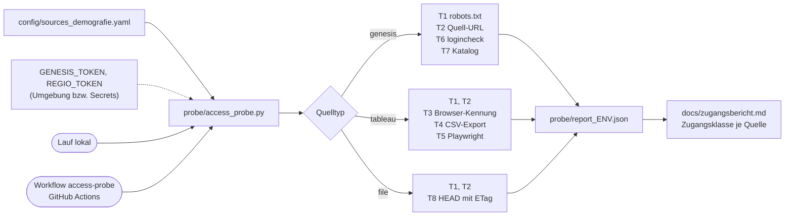
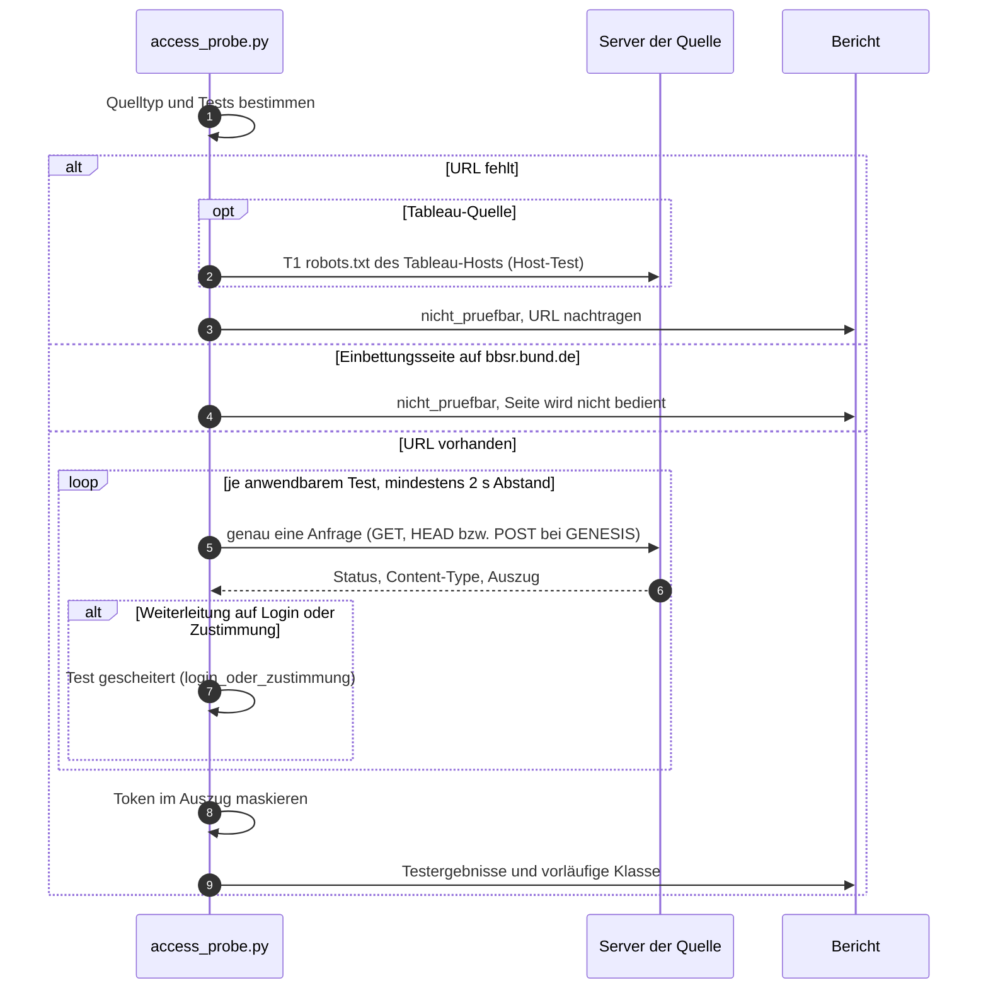
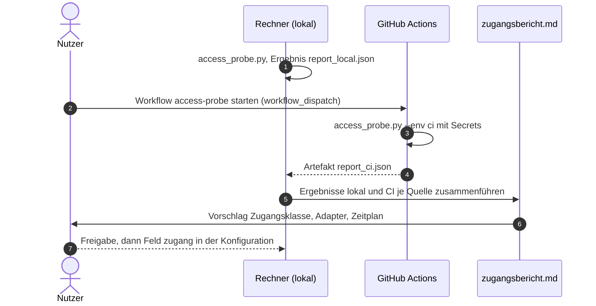

# Design

## Context

Greenfield-Repo. Die Prüfung muss auf dem Rechner des Nutzers (Privatanschluss) und auf einem GitHub-Runner (Rechenzentrum) identisch laufen, damit Unterschiede auf die Herkunft zurückgehen und nicht auf den Code. GENESIS-Tokens liegen derzeit weder lokal noch als Secret vor.

## Architektur und Abläufe

### Bausteine

### Ablauf je Quelle

### Ablauf lokal und CI bis zur Freigabe

## Goals / Non-Goals

**Goals:**
- Ein einziges Skript, das in beiden Umgebungen dieselben Tests mit denselben Headern ausführt.
- Belastbare Rohbefunde (Statuscode, Content-Type, Auszug) statt Interpretation im Code; die Bewertung steht im Bericht.

**Non-Goals:**
- Kein Datenabruf in voller Grösse, keine Adapterlogik, keine Paket-Integration in `demografie_fetch`.
- Kein Klicken von Zustimmungsdialogen, kein Ausprobieren alternativer URLs.

## Decisions

- **Standalone-Skript statt Paketmodul.** Das Skript hängt nur von `requests`, `PyYAML` und optional `playwright` ab, damit es auf jedem Rechner ohne Projektinstallation läuft. Alternative (Teil des Pakets) verworfen: Das Paket existiert erst nach der Freigabe.
- **Eine Anfrage je Test, Header explizit.** T2 mit Standard-User-Agent von `requests`, T3/T4 mit Chrome-User-Agent und `Referer: https://www.bbsr.bund.de/`. So ist der Unterschied zwischen T2 und T3 genau die Kennung.
- **Weiterleitungen folgen und protokollieren** (`allow_redirects=True`, die Kette aus `history` wird bis 5 Schritte mitgeschrieben). Endet die Kette auf einer Anmelde- oder Zustimmungsseite, gilt der Test als gescheitert. Ursprünglich war `allow_redirects=False` geplant; bei der Umsetzung wurde gefolgt, weil sonst eine harmlose Weiterleitung (z. B. http → https) schon als Ergebnis gälte.
- **GENESIS:** POST mit `application/x-www-form-urlencoded`, Token im Header `username`, leeres `password`. T6 = `helloworld/logincheck`. T7 = `catalogue/tables` mit `selection=<tabellencode>` bzw. `selection=<statistik>*` für reine Statistik-Codes. Basis-URL Regionaldatenbank: `https://www.regionalstatistik.de/genesisws/rest/2020/`, durch T6 bestätigt. Tabellencode wird per Regex aus der URL gelesen (`\d{5}-[\dA-Z-]+` oder 5-stellige Statistik).
- **T5 mit Playwright:** headless, kein Klick. Gezählt werden Antworten, deren URL `bootstrapSession` enthält und deren Körper `dataDictionary` enthält; danach wird geprüft, ob die Toolbar-Schaltfläche „Download“ existiert und aktiv ist. Das Menü wird geöffnet (das ist kein Zustimmungsdialog), aber kein Download ausgelöst. Lokal wird das installierte Chrome per `channel="chrome"` genutzt, in CI das von Playwright installierte Chromium.
- **Auszug:** höchstens 300 Zeichen Text bzw. die ersten 3 Zeilen bei CSV (T4), Token durch `***` ersetzt. Cookies und Set-Cookie werden nicht gespeichert.
- **Klasse je Umgebung im Skript, Gesamtklasse im Bericht.** Das Skript kennt nur seine eigene Umgebung; die Zusammenführung lokal + CI erfolgt in `docs/zugangsbericht.md`.

## Risks / Trade-offs

- [Ohne Token liefern T6/T7 keinen Datenbeweis] → Ergebnis als `kein_token` markieren; Nachprüfung, sobald Tokens gesetzt sind (lokal per Umgebungsvariable, CI per Secret).
- [GitHub-Runner-IP ist nicht repräsentativ für jede Cloud] → Bericht nennt Runner-Typ und öffentliche IP-Region; ein selbst gehosteter Runner bleibt Option.
- [Tableau-URL der ROP 2045 fehlt] → Quelle bleibt `nicht_pruefbar`, T1 auf `tableau.bbsr.bund.de/robots.txt` läuft trotzdem als Host-Test (zeigt den Herkunftsfilter).

## Open Questions

- Tableau-URL des ROP-2045-Dashboards und Download-Link der Bayern-Prognose (vom Nutzer einzutragen).
