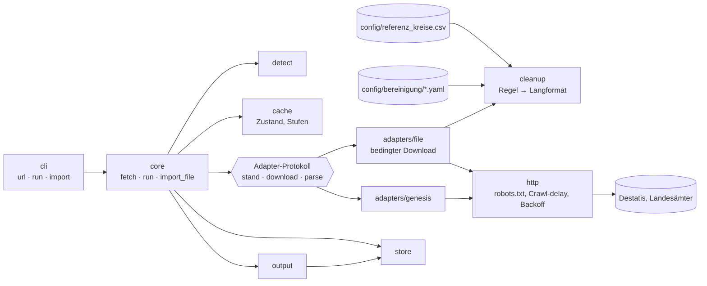
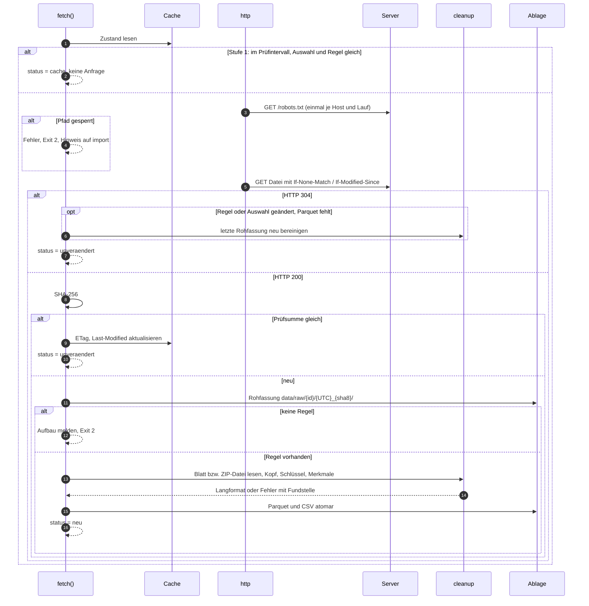
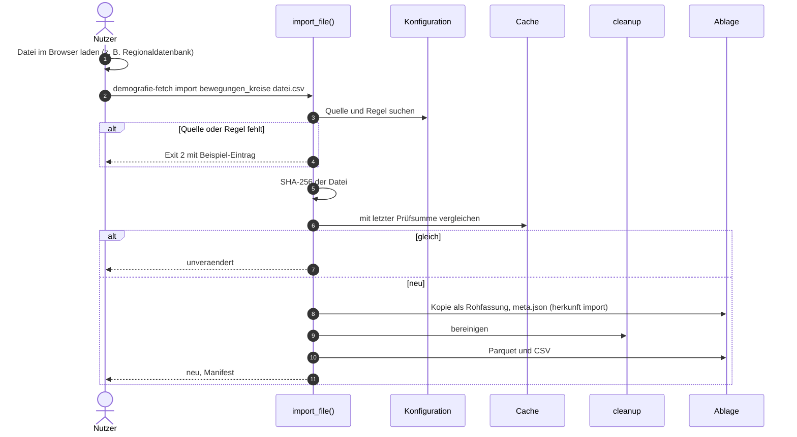
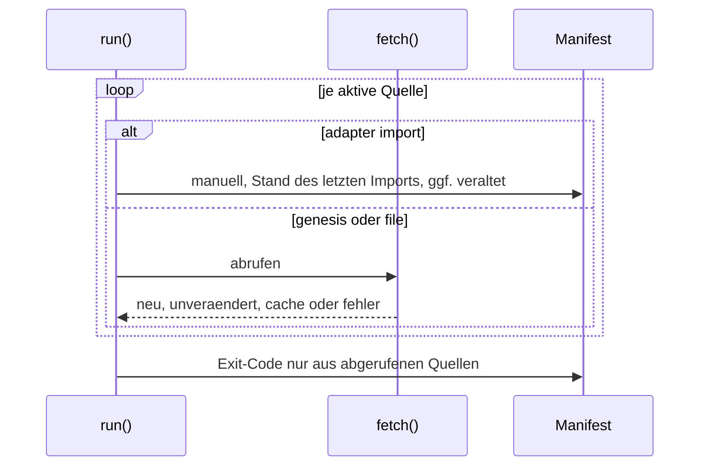

# Design

## Context

Siehe proposal.md. Heute ruft `core.fetch` den `GenesisClient` direkt auf (siehe archiviertes design von `add-genesis-adapter`, Entscheidung „Paketaufbau“). Mit `file` kommt der zweite Adapter, deshalb wird das gemeinsame Protokoll jetzt herausgezogen.

Beobachtet am 24.10.2026 an der Kreisliste des Gemeindeverzeichnisses (`https://www.destatis.de/DE/Themen/Laender-Regionen/Regionales/Gemeindeverzeichnis/Administrativ/04-kreise.xlsx?__blob=publicationFile&v=14`):

- `robots.txt` von destatis.de: kein `Disallow` für diesen Pfad, aber `Crawl-delay: 30`.
- Antwort: `ETag`, `Last-Modified`, `Cache-Control: max-age=60`, 86 kB.
- Blätter „Deckblatt“ und „Kreisfreie Städte u. Landkreise“. Im Datenblatt: Zeile 1 Titel mit Stichtag („… am 31.12.2024 (Jahr)“), Zeile 2 Spaltenköpfe mit Fußnotenzeichen (` Fläche km² ¹⁾`, `Bevölkerung auf Grundlage des ZENSUS 2022 ²⁾ insgesamt`), ab Zeile 3 Daten gemischt mit Zwischenzeilen (Schlüssel mit 2, 3 oder 4 Stellen), Summenzeilen („Insgesamt“, „Deutschland“), danach Quelle, Fußnoten und Copyright. Genau 400 Zeilen mit 5-stelligem Schlüssel, Werte als Zahlenzellen.

Ein Download der Regionaldatenbank liegt noch nicht vor (siehe Open Questions).

## Architektur und Abläufe

### Bausteine



### Ablauf Datei-Quelle mit bedingtem Download



### Ablauf `import`



### Manuelle Quellen im monatlichen Lauf



## Goals / Non-Goals

**Goals:**
- Neue Datei-Quellen ohne Code anbinden: URL plus Regel in `config/`.
- Gleiches Cache- und Ablageverhalten für `genesis`, `file` und `import`.

**Non-Goals:**
- Kein automatisches Erkennen von Spalten oder Köpfen; ohne Regel wird nur der Aufbau gezeigt.
- Keine Formate ausser CSV, XLSX, ZIP (kein XLS, ODS, PDF).
- Kein Abruf aus der Regionaldatenbank, auch nicht per Browser-Automatisierung.

## Decisions

- **Adapter-Protokoll.** `Adapter` mit `stand(ref, state) -> StandInfo` (bei `genesis`: `lastChange`; bei `file`: bedingte Anfrage, Ergebnis `unveraendert` oder geladene Bytes mit `ETag`/`Last-Modified`), `download(ref) -> RawBundle` (benannte Dateien für die Rohfassung) und `parse(raw_dir, opts) -> (long_df, info)`. `core.fetch` enthält die Stufenlogik einmal. Bei `file` fallen Stufe 2 und 3 in eine Anfrage zusammen (304 oder Datei). Alternative: Stufenlogik je Adapter, verworfen wegen Doppelung. Die bestehenden Tests von `genesis` müssen unverändert grün bleiben.
- **Regelformat (YAML), Beispiel `config/bereinigung/destatis_gv_kreise.yaml`:**
  ```yaml
  format: xlsx
  blatt: "Kreisfreie Städte u. Landkreise"
  kopfzeilen: [2]                 # 1-basiert; mehrere werden spaltenweise verbunden
  datenbeginn: 3
  schluessel: {spalte: "Amtlicher Regionalschlüssel", ebene: kreis}
  zeit: {aus_titel: {zeile: 1, muster: "am (\\d{2})\\.(\\d{2})\\.(\\d{4})", format: "{3}-{2}-{1}"}}
  merkmale:
    - {spalte: "Fläche km²", code: FLAECHE, label: "Fläche", einheit: "km²"}
    - {spalte: "Bevölkerung auf Grundlage des ZENSUS 2022 insgesamt", code: BEV_I, label: "Bevölkerung insgesamt", einheit: "Anzahl"}
    - {spalte: "Bevölkerung auf Grundlage des ZENSUS 2022 männlich", code: BEV_M, label: "Bevölkerung männlich", einheit: "Anzahl"}
    - {spalte: "Bevölkerung auf Grundlage des ZENSUS 2022 weiblich", code: BEV_W, label: "Bevölkerung weiblich", einheit: "Anzahl"}
    - {spalte: "Bevölkerung auf Grundlage des ZENSUS 2022 je km²", code: DICHTE, label: "Einwohner je km²", einheit: "je km²"}
  ```
  Weitere Felder: `kodierung` und `trennzeichen` (CSV, Standard `utf-8-sig` und automatisch `;`/`,`), `zip_datei`, `name: {spalte: …}` statt `schluessel`, `dimensionen: [{spalte, code}]`, `zeit: {wert: …}` oder `{spalte: …}`, `breit_ueber: {zeile: N, dimension: CODE}` für Tabellen mit Jahren als Spalten (z. B. Prognosen). Die Regel wird beim Laden gegen ein Schema geprüft. Ein Hash der Regel geht in den Auswahl-Schlüssel des Caches ein, damit eine geänderte Regel einen Neuaufbau auslöst.
- **XLSX lesen** mit `openpyxl` im Normalmodus (nicht `read_only`), weil nur so verbundene Zellen sichtbar sind; amtliche Dateien sind klein. Werte mit `data_only=True`, also die gespeicherten Ergebnisse von Formeln.
- **Fußnotenzeichen** per Muster entfernen: hochgestellte Ziffern `⁰-⁹`, `¹⁾`-Formen, `\d+\)` am Ende, `*`. Danach Leerzeichen vereinheitlichen.
- **Namensabgleich:** Kleinschreibung, Umlaute bleiben, Entfernen der Zusätze „, Stadt“, „, Landeshauptstadt“, „, Hansestadt“, „kreisfreie Stadt“, „Landkreis“, „Kreis“ nach Liste in `config/bereinigung/_namen.yaml`. Gibt es nach der Vereinheitlichung mehr als einen Treffer, wird abgebrochen und gemeldet (z. B. Stadt und Landkreis Rosenheim). Die Typangabe der Datei (z. B. Spalte „Regionale Bezeichnung“) kann über `name: {spalte, typ_spalte}` zur Unterscheidung dienen.
- **robots.txt** mit `urllib.robotparser` aus der Standardbibliothek, einmal je Host und Prozess, User-Agent `demografie-fetch`. Mindestabstand je Host = max(1 s, Crawl-delay). Der Abstand gilt je Host, nicht global.
- **HTTP 304** wird in `http` als normales Ergebnis zurückgegeben (kein Fehler). Bedingte Header nur, wenn der Zustand Werte hat.
- **Referenzliste aus dem Gemeindeverzeichnis.** Ein Skript `scripts/referenz_kreise.py` erzeugt `config/referenz_kreise.csv` aus dem Parquet von `gv_kreise` (Schlüssel und Name). Das Ergebnis wird mit der bisherigen Liste verglichen (400 gleiche Schlüssel). Das Skript läuft von Hand, nicht im Abruf.
- **Import-Ablage.** Die Datei wird byte-gleich nach `data/raw/<id>/<UTC>_<sha8>/<originalname>` kopiert. `meta.json` enthält den Dateinamen, aber nicht den lokalen Pfad.
- **Manuelle Quellen im Lauf.** Status `manuell` zählt für den Exit-Code nicht als Fehler und nicht als Erfolg.

## Risks / Trade-offs

- [Format der Regionaldatenbank unbekannt] → Regel `bewegungen_kreise` erst mit einer echten Datei; bis dahin bleibt die Quelle inaktiv.
- [Landesämter ändern das Layout ihrer Excel-Dateien] → Regelprüfung meldet fehlende Spalten mit den vorhandenen Köpfen; das alte Parquet bleibt.
- [Crawl-delay von 30 s verlängert Läufe] → Pro Host meist nur eine Anfrage je Lauf; der bedingte Download hält sie klein.
- [Umbau von `core.fetch`] → Bestehende Tests für `genesis` (Pflichtfälle 1–4) laufen unverändert als Regressionsschutz.

## Migration Plan

`config/sources_demografie.yaml`: `bewegungen_kreise` erhält `adapter: import` und `bereinigung: regio_bewegungen` (aktiv erst mit Regel), neue Quelle `gv_kreise`. Bestehende Rohfassungen und Zustände von `genesis`-Quellen bleiben gültig; das Feld für die Regel im Auswahl-Schlüssel ist dort leer, also ändert sich der Schlüssel nicht.

## Open Questions

- Beispieldatei der Regionaldatenbank (z. B. 12613-01-01-4, 12612-01-01-4, 12711-01-03-4 als CSV): nötig für die Regel `regio_bewegungen` (Aufgabe 5.2).
- Download-Link der Bayern-Prognose: ohne Link bleibt `laenderprognose_bayern` inaktiv; die Regel folgt dann mit einer späteren Änderung.
