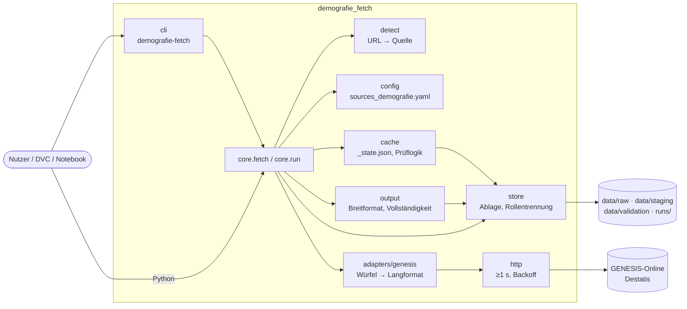
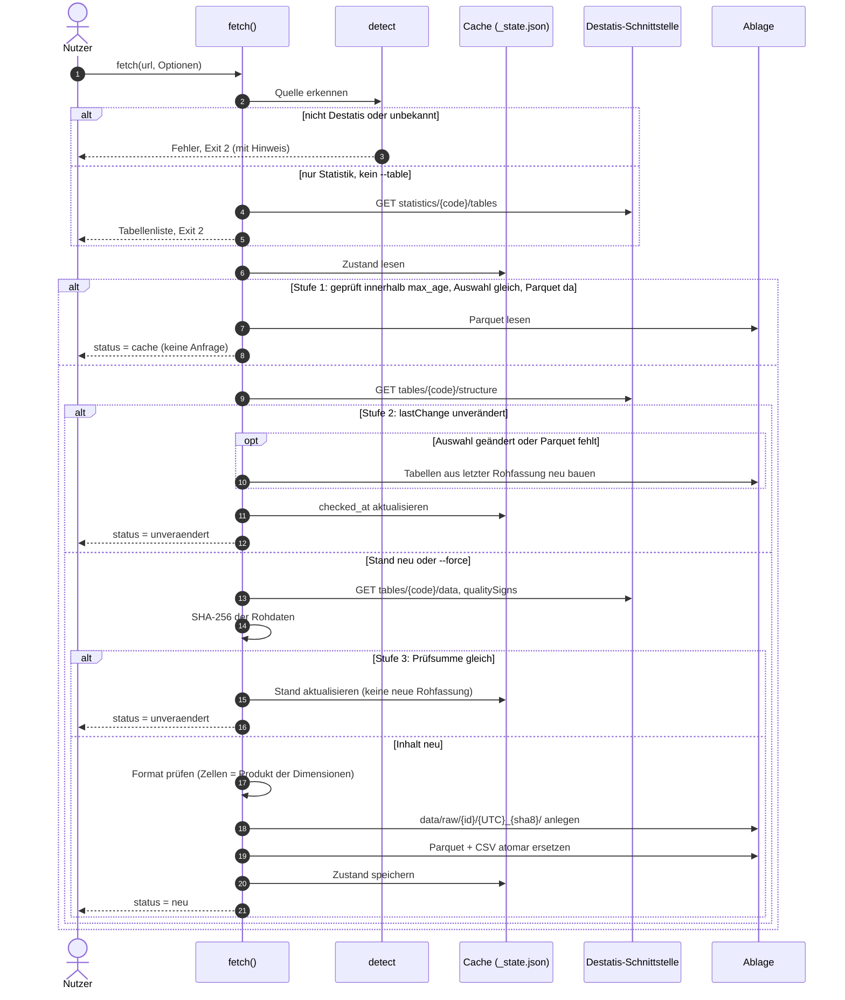
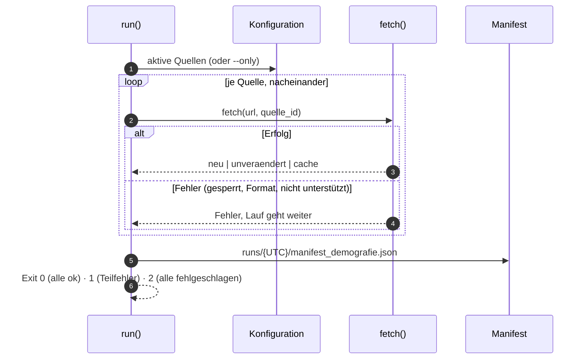
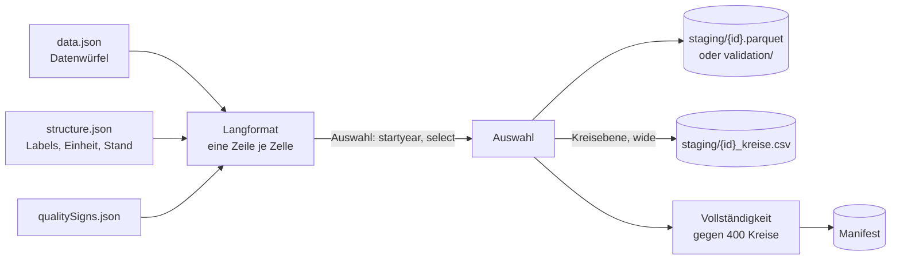

# Design

## Context

Siehe proposal.md und docs/zugangsbericht.md (Nachtrag). Die Web-Oberfläche `genesis.destatis.de/datenbank/online` liest ihre Daten per GET ohne Anmeldung von `https://genesis.destatis.de/genesis/api/rest/`. Beobachtete Endpunkte:

| Endpunkt | Inhalt | Grösse (Beispiel) |
|---|---|---|
| `tables/<code>/structure` | Titel, `lastChange`, Copyright, Variablen mit Typ (`TIME_*`, `REGION_CLASSIFYING`, `SUBJECT_CLASSIFYING`), Labels aller Werte (`variableValues`), Merkmale mit Einheit (`contents.<M>.functions.QMU.label`) und Nachkommastellen | einige 10 kB |
| `tables/<code>/data` | Datenwürfel im Stil von JSON-stat: `id`, `size`, `dimension.<D>.category.index`, `value[]`, `status[]` | 12421-0004: 17,8 MB, 2.026.944 Zellen; 12411-0017: 2,9 MB |
| `tables/<code>/qualitySigns` | `signsWithValue` (begleitend) und `signsReplacingValue` (ersetzend) | klein |
| `statistics/<code>/tables` | Tabellen einer Statistik mit `locationVariableCodes` | klein |
| `settings/instance` | Instanzinfo (für `check`) | klein |

Es gibt kein ETag und kein Last-Modified (`Cache-Control: no-store`). Die Änderungserkennung muss deshalb über `lastChange` und eine Prüfsumme laufen.

## Architektur und Abläufe

### Bausteine

### Ablauf `fetch(url)` mit Cache

### Ablauf `demografie-fetch run`

### Datenfluss

## Goals / Non-Goals

**Goals:**
- Ein schmaler Kern (Erkennung, HTTP, Cache, Ablage, Ausgabe), an den die Adapter `file` und `tableau` später andocken, ohne den Kern zu ändern.
- Unveränderte Quellen kosten höchstens eine kleine Metadaten-Anfrage, innerhalb des Prüfintervalls gar keine.

**Non-Goals:**
- Kein Zugriff auf die dokumentierte Token-REST-API (`genesisWS/rest/2020`). Kein Key verfügbar, die Anbindung käme als eigener Adapter.
- Keine serverseitige Auswahl. Die Web-Schnittstelle liefert immer den ganzen Würfel, die Auswahl wird lokal gefiltert.
- Kein Umschlüsseln bei Gebietsreformen, kein Rahmencheck.

## Decisions

- **Paketaufbau.** `detect` (URL zu `SourceRef`), `http` (höfliche Session), `adapters/genesis` (Client und Würfel→Langformat), `cache` (Zustand, Prüflogik, Rohablage), `store` (Pfade, atomare Parquet/CSV, Rollentrennung, einziger Ort mit `data/validation`), `output` (Breitformat, Vollständigkeit, Zahlenparser), `core` (`fetch`, `run`, Manifest), `cli`. Adapter erfüllen ein Protokoll mit `check_stand()`, `download()`, `parse(raw) -> (long_df, meta)`. So steckt die Cache-Logik nur einmal im Kern. Ein Modul je Adapter mit eigenem Cache wäre die Alternative gewesen; verworfen, weil sich die Logik dann verdoppelt.
- **Cache in drei Stufen.** (1) Liegt `checked_at` im Prüfintervall und gibt es das Parquet: Antwort aus dem Cache. (2) Sonst `structure` holen. Bei gleichem `lastChange` und vorhandenem Parquet ist die Quelle unverändert. Bei geänderter Auswahl oder fehlendem Parquet werden die Tabellen aus der letzten Rohfassung neu gebaut. (3) Sonst `data` und `qualitySigns` holen, SHA-256 über die Bytes von `data` bilden. Ist die Summe gleich, kein neues Rohverzeichnis. Ist sie neu, entsteht `data/raw/<id>/<UTC>_<sha8>/` mit `data.json`, `structure.json`, `qualitySigns.json` und `meta.json`. Die Prüfsumme geht über die Rohbytes und nicht über das geparste Ergebnis. Grund: Die Vorgabe „Original unverändert“ macht die Rohbytes zur Quelle der Wahrheit. Eine Umsortierung der Antwort ohne inhaltliche Änderung führt dann zwar zu einer zusätzlichen Fassung, verliert aber nichts.
- **Prüfintervall-Standard 6 h.** Wiederholte Aufrufe im Notebook bleiben so schnell und offline, und der monatliche Lauf ist nicht betroffen. `run` aus CI nutzt `--max-age 0`, weil der Cache dort ohnehin leer ist.
- **Atomare Schreibvorgänge.** Schreiben in eine temporäre Datei im Zielordner, dann `os.replace`. Gilt für Parquet, CSV, `_state.json` und das Manifest.
- **Würfel zu Langformat.** Die Zellnummer wird per Stride-Arithmetik mit NumPy in Dimensionsindizes zerlegt, das ist vektorisiert. Die Codes der Dimensionen kommen aus `category.index`, die Labels aus `structure.variableValues`. Die Dimensionen `statistic` und `content` werden zu `tabelle`, `merkmal_code`, `merkmal_label` und `einheit`. Der Inhalts-Code `BEV050$QMU` wird an `$` getrennt, `QMU` steht für Wert in Einheit. Den Status je Zelle ordnet `qualitySigns` zu: ersetzende Zeichen landen in `sonderzeichen` und machen `wert` zu NaN, begleitende landen in `qualitaet`. `e` (endgültig, in GENESIS ausgeblendet) wird als `e` übernommen. `status` kann eine Liste oder ein Objekt sein; beides wird gelesen.
- **Zeitdimension.** Variablen vom Typ `TIME_*` heissen im Ergebnis `zeit`. Der Wert bleibt Text wie geliefert (`2024-12-31` oder `2024`). `startyear`/`endyear` vergleichen die ersten vier Zeichen.
- **Regionalspalten.** `KREISE` ergibt `ags5`, `DLAND` ergibt `land`. Die Codes werden auf 5 bzw. 2 Stellen mit Nullen aufgefüllt. Andere Regionsvariablen (z. B. `DINSG`) bleiben normale Dimensionen.
- **Wertetyp.** `float64`. Die JSON-Zahlen der Schnittstelle sind Dezimalwerte mit höchstens den veröffentlichten Nachkommastellen (z. B. 1 bei 12421-0004) und lassen sich verlustfrei rundreisen. `Decimal` wurde verworfen, weil DuckDB und Parquet dann für jede Spalte einen eigenen Maßstab bräuchten.
- **Breitformat.** `pivot` über `ags5` plus die `--wide`-Dimensionen. Die Spaltennamen sind `merkmal_code` und `__`-getrennte Codes der restlichen Dimensionen (z. B. `BEVSTD__ALT000B03`). Die CSV hat UTF-8, Komma und `.` als Dezimaltrenner, damit sie maschinenlesbar bleibt.
- **Referenzliste.** `config/referenz_kreise.csv` (ags5, name) mit den 400 Kreisen am Stichtag 2024-12-31, abgeleitet aus Destatis 12411-0015 und eingecheckt. Ein Datensatz aus dem Gemeindeverzeichnis wäre unabhängiger, ist aber nur als XLSX zu haben und kann mit `add-file-and-import` getauscht werden. Die Herkunft steht im Kopf der Datei.
- **HTTP.** Eine `requests.Session` mit `User-Agent: demografie-fetch/<version> (+https://github.com/trosinde/demografie-fetch)`, mindestens 1 s Abstand und bis zu drei Wiederholungen mit Backoff 2/4/8 s bei 429, 5xx und Netzwerkfehlern. Timeout 300 s für `data`. Bei 401/403 wird nicht wiederholt.
- **Tests ohne Netzwerk.** Ein kleiner, echter Ausschnitt von Antworten liegt gekürzt in `tests/fixtures/` (structure, data, qualitySigns, statistics). HTTP wird über eine austauschbare Transportfunktion gemockt. Live-Tests tragen den Marker `live`.

## Risks / Trade-offs

- [Nicht dokumentierte Schnittstelle kann sich ändern] → Formatprüfung (Requirement „Formatänderung erkennen“) bricht nur die Quelle ab, das alte Parquet bleibt. Der monatliche Live-Lauf macht Änderungen schnell sichtbar.
- [Destatis könnte die Schnittstelle für Nicht-Browser sperren] → Eigene, ehrliche Kennung und kein Umgehen; dann Wechsel auf `import` oder Token-API.
- [Grosse Tabellen (z. B. Kreise × Altersjahre) könnten zu gross für einen Abruf sein] → Fehler mit Hinweis, eine kleinere Tabelle zu wählen; HTTP-Fehler bleiben je Quelle isoliert.
- [Referenzliste aus derselben Quelle] → deckt Abschneiden und Formatfehler auf, aber keine Fehler der Quelle selbst; Tausch gegen das Gemeindeverzeichnis ist vorgesehen.

## Migration Plan

Neu, keine Migration. `config/sources_demografie.yaml`: `bevoelkerung_kreise_alter` zeigt auf Destatis 12411-0017. Rollback: Repo-Stand zurücksetzen. Rohdaten unter `data/` bleiben unberührt.
