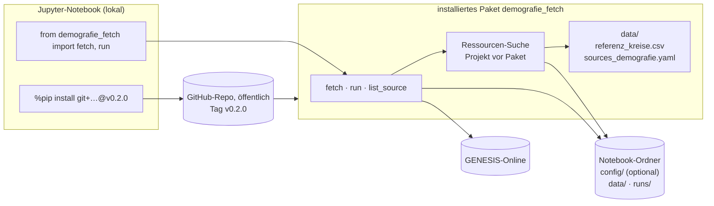
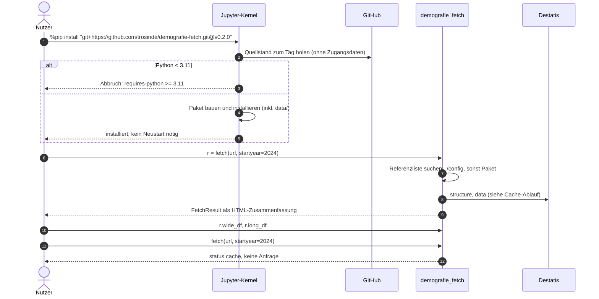
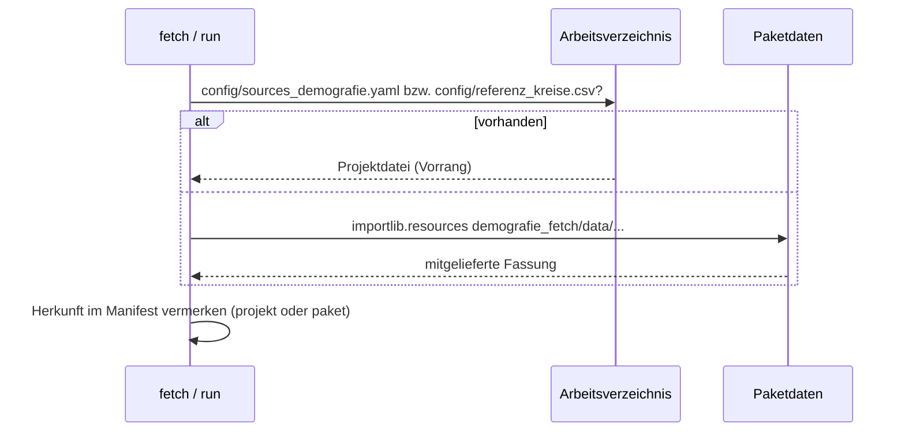
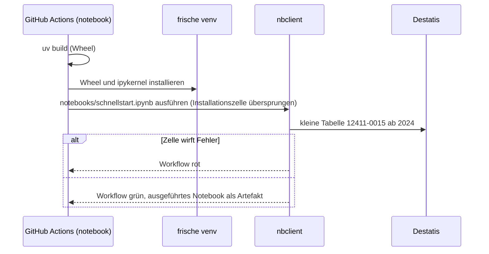

# Design

## Context

Siehe proposal.md. Befund vom 24.10.2026: Das mit `uv build` gebaute Wheel enthält nur `src/demografie_fetch/**/*.py`. Installiert in eine frische Umgebung und außerhalb des Repos aufgerufen, liefert `fetch()` die Daten korrekt, aber `vollstaendigkeit = {"fehler": "Referenzliste config/referenz_kreise.csv fehlt"}`. `run()` findet ohne `config/sources_demografie.yaml` im Arbeitsverzeichnis keine Quellen.

Zielumgebung laut Nutzer: lokales Jupyter (JupyterLab oder VS Code), Installation aus dem dann öffentlichen GitHub-Repo.

## Architektur und Abläufe

### Bausteine

### Installation und erster Abruf im Notebook

### Ressourcen-Suche

### Notebook in CI

## Goals / Non-Goals

**Goals:**
- Eine Installationszelle und ein `import` genügen für alle Funktionen.
- Das Beispiel-Notebook ist durch CI abgesichert und veraltet nicht still.

**Non-Goals:**
- Kein PyPI-Paket, keine Colab- oder JupyterHub-Anpassungen.
- Keine Diagramme oder Karten im Paket (keine Abhängigkeit von matplotlib); das Notebook nutzt nur pandas.
- Keine Fortschrittsbalken; Meldungen über `logging`.

## Decisions

- **Paketdaten unter `src/demografie_fetch/data/`**, gelesen mit `importlib.resources.files`. Hatchling nimmt Nicht-Python-Dateien im Paketordner automatisch ins Wheel auf; ein Test prüft das am gebauten Wheel. `config/referenz_kreise.csv` bleibt im Repo als Projektdatei; ein Test stellt sicher, dass beide Fassungen identisch sind. Alternative „nur im Paket“ verworfen: Dann ließe sich die Liste im Projekt nicht übersteuern.
- **Suchreihenfolge** für Konfiguration und Referenzliste: expliziter Parameter, dann `./config/…`, dann Paket. Die Herkunft steht im Manifest (`konfiguration: projekt|paket|<pfad>`).
- **Installation per Git-Tag** statt Branch, damit ein Notebook reproduzierbar dieselbe Version nutzt. `%pip` (nicht `!pip`) installiert in die Umgebung des laufenden Kernels.
- **`RunResult` als `NamedTuple`** mit zusätzlicher Methode `to_frame()`. Bestehender Code mit `code, path, entries = run(...)` funktioniert weiter.
- **`FetchResult._repr_html_`** und `__repr__` geben eine kompakte Tabelle aus. Die Datenrahmen bleiben über `long_df` und `wide_df` erreichbar.
- **CI-Workflow `notebook.yml`** für Pull Requests und Pushes auf `main`, die `src/`, `notebooks/` oder `pyproject.toml` ändern. Er baut das Wheel, installiert es mit `ipykernel` und `nbclient` in eine frische venv und führt das Notebook aus. Die Installationszelle trägt den Tag `skip-ci` und wird übersprungen, weil das Wheel des aktuellen Stands getestet werden soll und nicht der letzte Tag. Abgerufen wird nur eine kleine Tabelle (12411-0015 ab 2024, rund 200 kB).
- **Veröffentlichung des Repos (Entscheidungspunkt).** Die Prüfung vom 24.10.2026 ergab:
  - Die Commit-Historie nennt die private Mailadresse als Autor.
  - `docs/zugangsbericht.md` und `probe/report_local.json` nennen Anbieter und Region des Privatanschlusses.
  - Keine Tokens, keine lokalen Pfade, keine IP-Adressen.

  Optionen:
  - (a) so veröffentlichen.
  - (b) Anbieter und Region in beiden Dateien auf „Privatanschluss, DE“ kürzen. Die Historie enthält sie weiterhin.
  - (c) wie (b), dazu die Historie vor der Veröffentlichung neu schreiben, sodass Anbieter, Region und Mailadresse auch in alten Commits fehlen (Force-Push auf `main`, alte PR-Verweise zeigen dann auf andere Commits).

  Empfehlung: (b), und für künftige Commits die GitHub-noreply-Adresse verwenden. Die Mailadresse ist in Commits üblich; Anbieter und Region sind für den Bericht unwichtig. Die Sichtbarkeit wird erst nach der Freigabe in Aufgabe 4.2 umgestellt.

## Risks / Trade-offs

- [Öffentliches Repo macht die Nutzung der nicht dokumentierten Destatis-Schnittstelle sichtbar] → README nennt die Schnittstelle bereits offen, die Kennung ist ehrlich, die Last gering; das ändert sich nicht.
- [Notebook-Test in CI hängt von Destatis ab] → kleine Tabelle; schlägt Destatis fehl, ist der Workflow rot, aber getrennt vom Workflow `ci`.
- [Doppelte Referenzliste (Projekt und Paket)] → Test auf Gleichheit.

## Migration Plan

Keine Datenmigration. Nach dem Merge: Tag `v0.2.0` setzen, danach erst Installation im Notebook mit diesem Tag. Rückweg: Repo wieder privat stellen (Installationen per Git ohne Zugangsdaten schlagen dann fehl).
