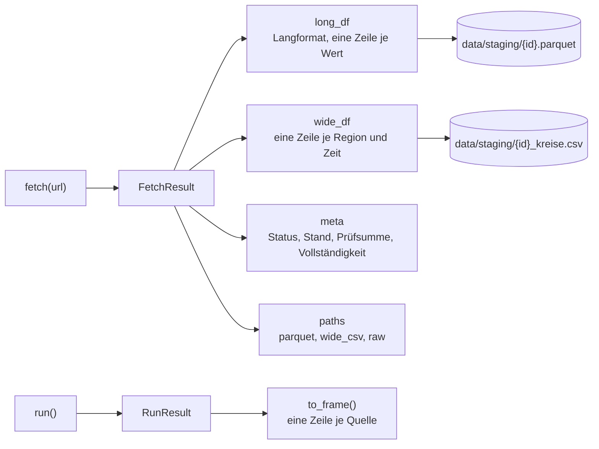
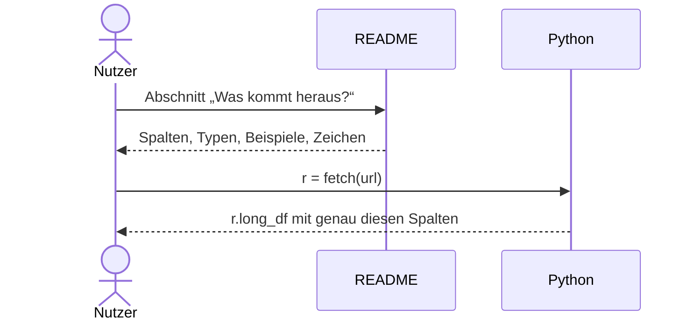

# Design

## Context

Siehe proposal.md. Ermittelte Rückgabe (24.10.2026, Version 0.2.0):

- Langformat Kreisebene (12411-0017): `quelle_id, tabelle, zeit, ags5, altx20_code, altx20_label, kreise_code, kreise_label, merkmal_code, merkmal_label, einheit, wert, sonderzeichen, qualitaet`.
- Langformat Länderebene (12421-0004): `quelle_id, tabelle, zeit, land, ges_code, ges_label, bevpr2_code, bevpr2_label, dland_code, dland_label, alt101_code, alt101_label, merkmal_code, merkmal_label, einheit, wert, sonderzeichen, qualitaet`.
- Typen: `wert` ist `float64`, alle anderen Spalten sind pandas-`category` mit Textwerten (im Parquet als Dictionary-kodierter Text).
- Breitformat Kreisebene: `ags5, kreise_label, zeit, BEVSTD__ALT000B03, …`; Länderebene: `land, dland_label, zeit, BEV050__GESM__BEV-VARIANTE-01__ALT000, …` (nur `wide_df`, keine CSV-Datei).
- `meta`: `quelle_id, url, tabelle, rolle, status, stand, sha256, zeilen, titel, vollstaendigkeit`, optional `veraltet`. `paths`: `parquet, raw`, bei Kreisebene `wide_csv`.
- Zeichen laut `qualitySigns` von GENESIS-Online: ersetzend `-`, `.`, `...`, `/`, `x`; begleitend `e`, `p`, `r`, `s`, `0`, `()`.

## Architektur und Abläufe

### Aufbau des Rückgabeobjekts

### Wie die README gelesen wird

## Goals / Non-Goals

**Goals:**
- Jede zurückgegebene Spalte und jedes Feld ist in der README erklärt, mit Typ und Beispiel.

**Non-Goals:**
- Keine Änderung an Spaltennamen oder Typen.

## Decisions

- **Ort:** im bestehenden Abschnitt „Was kommt heraus?“, damit Nutzer nicht in die Specs schauen müssen. Die Specs bleiben die verbindliche Quelle; die README verweist auf `openspec/specs/table-output/spec.md`.
- **Quellabhängige Spalten** als Muster `<dim>_code`/`<dim>_label` erklären und mit einer kleinen Tabelle der bisher vorkommenden Dimensionen (`kreise`, `dland`, `altx20`, `alt101`, `ges`, `bevpr2`) belegen; `list_source(url)` nennt die Dimensionen jeder Tabelle.
- **Beispiele aus echten Abrufen**, nicht erfunden.

## Risks / Trade-offs

- [README und Code laufen auseinander] → Ein Test prüft, dass die in der README genannten festen Spalten des Langformats mit der Rückgabe aus den Fixtures übereinstimmen.
